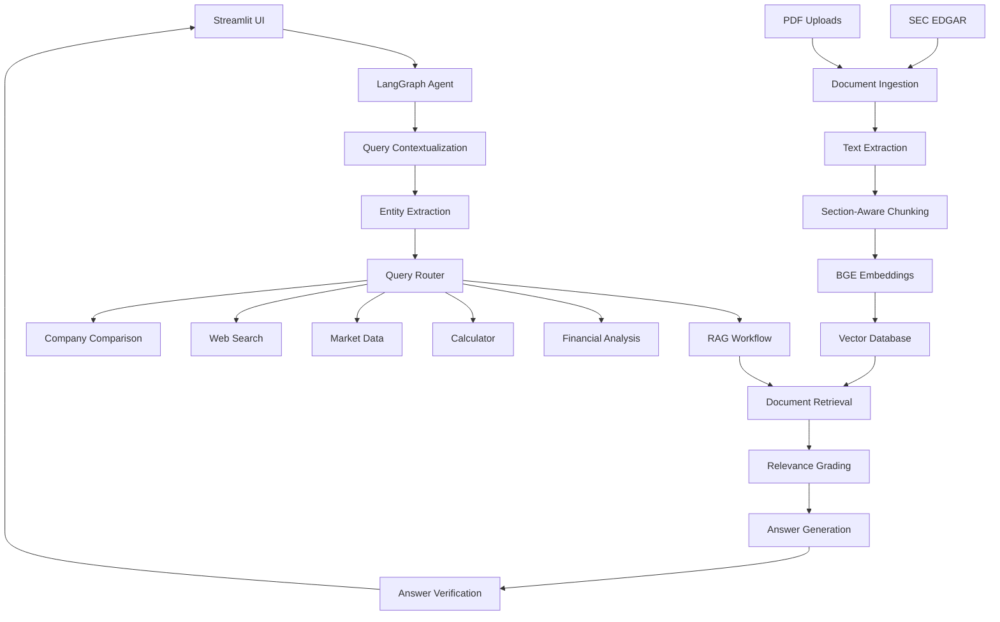

# Financial Analyst Agent

An AI-powered financial research assistant that answers questions about company financial reports, performs financial calculations, compares companies, and retrieves recent financial market information using RAG and agentic workflows.

**Live Demo:** [Financial Analyst Agent](https://financial-analyst-agent-fe6lrixvaxr35cywrpn5w.streamlit.app/)

---

## Overview

Financial Analyst Agent is a Streamlit-based application designed to simplify financial research.

It combines Retrieval-Augmented Generation (RAG), LangGraph workflows, financial calculation tools, stock market data, and web search to provide contextual answers about Apple, Microsoft, and NVIDIA.

Users can query SEC filings, upload their own financial reports, ask follow-up questions, perform financial analysis, and compare companies.

## Features

### 1. Retrieval-Augmented Generation (RAG)
- Ingests SEC 10-K and 10-Q filings.
- Supports user-uploaded PDF financial reports.
- Extracts text from HTML and PDF documents.
- Uses section-aware chunking for SEC filings.
- Generates embeddings using BGE (`BAAI/bge-small-en-v1.5`).
- Performs semantic search using vector databases.
- Provides source-aware answers based on retrieved documents.

### 2. Agentic Workflow with LangGraph
- Conditional routing based on user queries.
- Routes questions to specialized workflows.
- Supports contextual query rewriting for follow-up questions.
- Extracts entities such as companies, financial metrics, and fiscal years.
- Grades retrieved document relevance.
- Rewrites queries when retrieval results are insufficient.
- Verifies generated answers against retrieved context.

### 3. Financial Analysis
Includes tools for:
- Revenue growth calculation.
- Net profit margin calculation.
- Debt-to-equity calculation.
- General mathematical calculations.

### 4. Multi-Company Comparison
Supports financial comparisons across:
- Apple (AAPL)
- Microsoft (MSFT)
- NVIDIA (NVDA)

Uses parallel company-level analysis before generating a consolidated comparison.

### 5. Stock Market Data
- Retrieves historical stock prices using yfinance.
- Displays historical price charts.
- Supports multiple historical periods: 1 month, 3 months, 6 months, 1 year, 2 years, and 5 years.
- Retrieves company market information.

### 6. Financial Web Search
- Searches for recent financial news and information.
- Uses Tavily search.
- Summarizes retrieved web results using an LLM.

### 7. Conversation Memory
- Maintains conversational context.
- Supports follow-up questions and references to previously discussed companies.
- Uses LangGraph checkpointing with PostgreSQL.

### 8. Document Storage
- Stores uploaded PDF files in Supabase Storage.
- Stores document chunks and embeddings in Supabase pgvector.
- Retains local ChromaDB support for development.

---

## Architecture

The application follows a modular architecture with separate components for ingestion, retrieval, orchestration, financial tools, and the user interface.

### High-Level Architecture



### RAG Pipeline

```text
SEC Filings / PDF Uploads
          |
          v
    Text Extraction
          |
          v
   Section-Aware Chunking
          |
          v
     BGE Embeddings
          |
          v
     Vector Database
          |
          v
      User Query
          |
          v
   Semantic Retrieval
          |
          v
   Relevance Grading
          |
          v
   Answer Generation
          |
          v
   Answer Verification
          |
          v
      Final Answer
```

---

## Tech Stack

| Category | Technologies |
|---|---|
| Programming Language | Python |
| User Interface | Streamlit |
| Agent Orchestration | LangGraph |
| LLM | Groq |
| LLM Integration | LangChain |
| Embeddings | Hugging Face Sentence Transformers |
| Embedding Model | BAAI/bge-small-en-v1.5 |
| Vector Database | ChromaDB, Supabase pgvector |
| Database | PostgreSQL |
| Document Extraction | PyMuPDF, BeautifulSoup |
| Financial Market Data | yfinance |
| Web Search | Tavily |
| Database Checkpointing | LangGraph PostgreSQL Checkpointer |
| Deployment | Streamlit Community Cloud |

---

## Project Structure

```text
financial-analyst-agent/
│
├── agent/
│   ├── graph.py
│   ├── state.py
│   ├── router.py
│   ├── retrieval.py
│   ├── verification.py
│   ├── comparison.py
│   ├── contextualizer.py
│   ├── entities.py
│   ├── memory.py
│   ├── checkpointer.py
│   └── tools.py
│
├── config/
│   ├── settings.py
│   └── __init__.py
│
├── ingestion/
│   ├── sec_downloader.py
│   ├── html_loader.py
│   ├── pdf_loader.py
│   ├── upload_pipeline.py
│   └── sec_pipeline.py
│
├── llm/
│   └── groq_client.py
│
├── rag/
│   ├── document_processor.py
│   ├── chunker.py
│   ├── embeddings.py
│   ├── vector_store.py
│   ├── supabase_vector_store.py
│   ├── retriever.py
│   └── qa_chain.py
│
├── tools/
│   └── market_data.py
│
├── utils/
│   ├── logger.py
│   ├── document_manager.py
│   └── supabase_storage.py
│
├── tests/
│
├── app.py
├── requirements.txt
├── .gitignore
└── README.md
```

---

## Getting Started

### Prerequisites

- Python 3.10+
- Git
- Groq API key
- Hugging Face access (optional token for higher Hub rate limits)
- Tavily API key
- Supabase project

### 1. Clone the repository

```bash
git clone <YOUR_GITHUB_REPOSITORY_URL>
cd financial-analyst-agent
```

### 2. Create a virtual environment

```bash
python -m venv venv
```

Activate it on Windows:

```powershell
.\venv\Scripts\Activate.ps1
```

### 3. Install dependencies

```bash
pip install -r requirements.txt
```

### 4. Configure environment variables

Create a `.env` file in the project root.

```env
# LLM
GROQ_API_KEY=your_groq_api_key
GROQ_MODEL=openai/gpt-oss-120b

# Embeddings
EMBEDDING_MODEL=BAAI/bge-small-en-v1.5

# SEC EDGAR
SEC_USER_AGENT=YourAppName your_email@example.com

# Web Search
TAVILY_API_KEY=your_tavily_api_key

# Vector Store
VECTOR_STORE=chroma

# Supabase
SUPABASE_URL=your_supabase_project_url
SUPABASE_SERVICE_ROLE_KEY=your_supabase_service_role_key
SUPABASE_DB_URL=your_supabase_database_connection_string

# LangGraph Checkpointer
LANGGRAPH_DATABASE_URL=your_postgres_connection_string
```

Use your actual configured values. Never commit `.env` or expose service-role credentials.

### 5. Configure Supabase

Enable the `vector` extension in your Supabase PostgreSQL database.

Create the document chunks table:

```sql
CREATE EXTENSION IF NOT EXISTS vector;

CREATE TABLE IF NOT EXISTS financial_document_chunks (
    id TEXT PRIMARY KEY,
    content TEXT NOT NULL,
    metadata JSONB NOT NULL DEFAULT '{}'::jsonb,
    embedding VECTOR(384) NOT NULL,
    created_at TIMESTAMPTZ DEFAULT NOW()
);
```

Create private Supabase Storage buckets:

- `financial-reports` – uploaded PDF reports.
- `sec-filings` – original SEC HTML filings.

Configure the required PostgreSQL connection and storage credentials in your environment.

### 6. Download SEC filings

Download filings for supported companies:

```powershell
python -m ingestion.sec_downloader --all --limit 2
```

You can also download filings for a specific company:

```powershell
python -m ingestion.sec_downloader --ticker AAPL --forms 10-K --limit 3
```

### 7. Run the application

```bash
streamlit run app.py
```

Open the local Streamlit URL displayed in your terminal.

---

## Supported Companies

| Company | Ticker |
|---|---|
| Apple | AAPL |
| Microsoft | MSFT |
| NVIDIA | NVDA |

## Data Sources

- **SEC EDGAR:** Company annual and quarterly filings.
- **User-uploaded PDFs:** Financial reports uploaded through the application.
- **yfinance:** Historical stock market data and company market information.
- **Tavily:** Recent financial web search results.

## Deployment

The application is deployed using Streamlit Community Cloud.

**Live Application:** https://financial-analyst-agent-fe6lrixvaxr35cywrpn5w.streamlit.app/

Cloud deployments use Supabase for document storage and vector retrieval. Configure all required credentials through Streamlit Cloud Secrets rather than committing environment files.

---

## Current Limitations

- The application currently supports three predefined companies.
- Scanned PDFs without extractable text require OCR, which is not currently implemented.
- Stock market data is provided by yfinance and may be delayed or incomplete; it is not a real-time exchange feed.
- Financial calculations depend on the accuracy of the extracted or supplied input values.
- LLM-based answer verification does not guarantee mathematical correctness.
- SEC HTML filings do not provide reliable PDF-style page numbers.
- Comprehensive end-to-end evaluation and citation improvements are still planned.

## Future Improvements

- Improve source citation accuracy and presentation.
- Add systematic RAG evaluation and answer-quality benchmarks.
- Expand automated end-to-end testing.
- Improve document retrieval and metadata quality.

---

## Disclaimer

This application is intended for financial research and educational purposes only. It does not provide investment advice or recommendations.

Financial information should always be verified against original company filings and trusted market data sources.

---

## Author

**Sagar**

M.Tech, Computer Science — IIT Delhi

